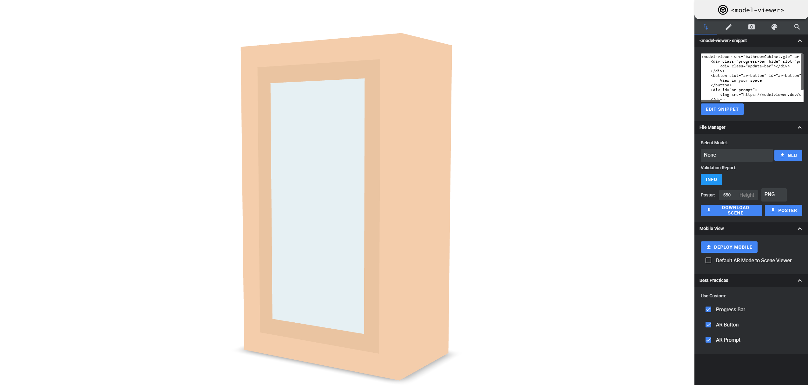

para poder general las capturas de los modelos y queden en la barra lateral entrar a estas url : 
-   
y seleccionar la opcion de png -> dowload poster

lucas estos son los pasos que debes de realizar o las cosas que debes de realizar
1- cambiar el nombre de los materiales a español
2- sacar captura de los modelos y subirlos a la db mediante el metodo que esta puesto arriba de este texto
3- subir los 100 modelos faltantes para tener más materiales para usar
4- subes al git los cambios pero si te genera problemás, me dices por discord.